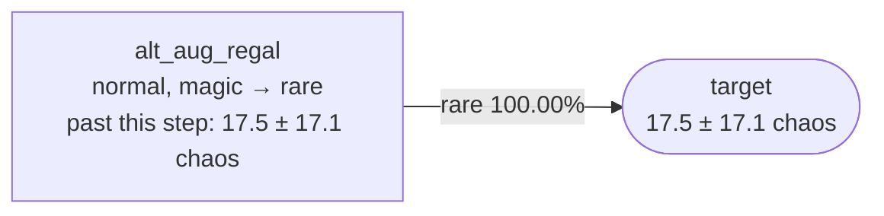
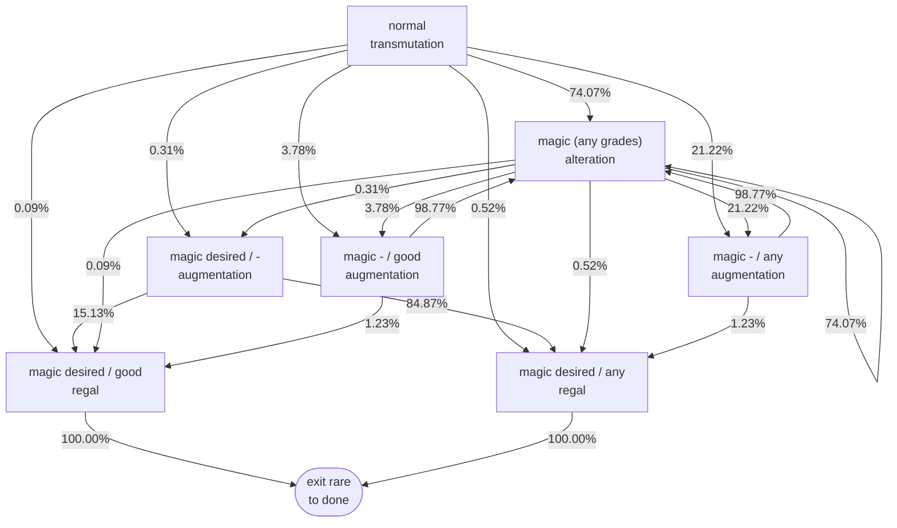

# Supreme Spiked Shield (shaper), item level 87

- prefix pool: 73 modifiers, total weight 64800
- suffix pool: 131 modifiers, total weight 96475
- one desired prefix: 1/81 = 1.2346%
- one good prefix: 5/81 = 6.1728%
- one good suffix: 584/3859 = 15.1335%
- target: a rare item, prefixes [desired], suffixes []

The strategy is written down and this says what it costs. A chance is used one step deep; what is carried from step to step is the cost to get there and its spread.

## Currencies

| currency | works on | one use costs | weight (chaos) |
|---|---|---|---|
| transmutation | normal | 1 transmutation | 0.02 |
| alteration | magic | 1 alteration | 0.2 |
| augmentation | magic | 1 augmentation | 0.05 |
| regal | magic | 1 regal | 0.5 |
| exalted | rare | 1 exalted | 2 |
| scouring | magic, rare | 1 scouring | 0.5 |

## Craft: shield (forward)

| step | method | takes | chance | tries | one run costs | cost to get past it | chaos ± sd |
|---|---|---|---|---|---|---|---|
| 0 | alt_aug_regal | normal, magic | 100.00% | 1.00 | alteration 80.00, augmentation 20.50, regal 1.00, transmutation 1.00 | alteration 80.00, augmentation 20.50, regal 1.00, transmutation 1.00 | 17.5 ± 17.1 |

Whole craft, per orb: alteration 80.00 ± 80.50, augmentation 20.50 ± 20.50, regal 1.00 ± 0.00, transmutation 1.00 ± 0.00

## Method: alt_aug_regal (step 0)

## Other moves

27 other moves checked at 11 places the craft passes through; 1 cost less to finish, by the weights.

| step | item | visits | planned | to finish (chaos) | instead | to finish (chaos) |
|---|---|---|---|---|---|---|
| 0 | magic desired / - | 0.25 | augmentation | 0.55 | regal | 0.50 |

