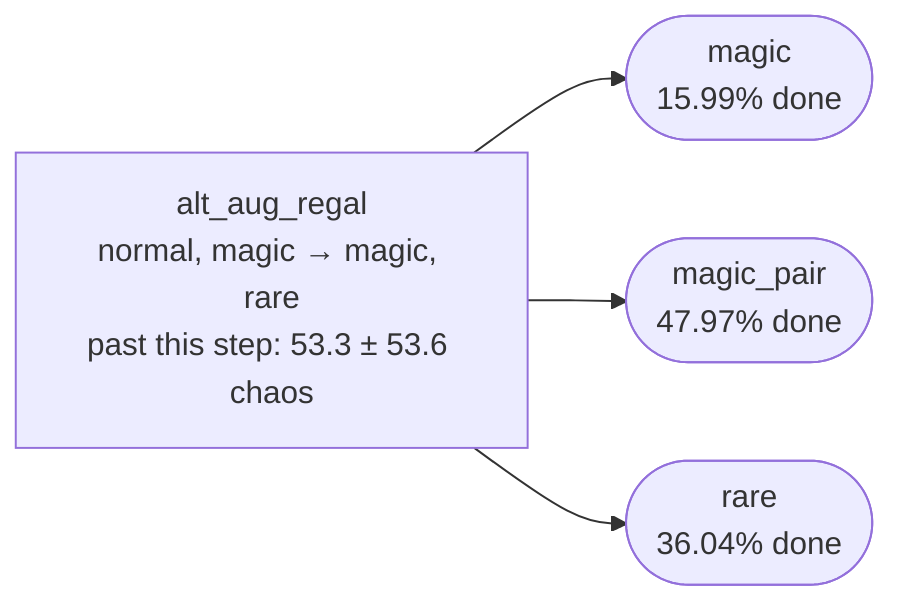
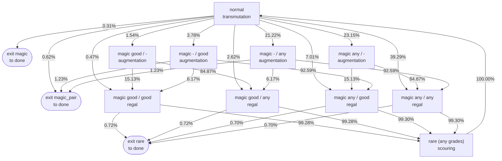

# Supreme Spiked Shield (shaper), item level 87

- prefix pool: 73 modifiers, total weight 64800
- suffix pool: 131 modifiers, total weight 96475
- one desired prefix: 1/81 = 1.2346%
- one good prefix: 5/81 = 6.1728%
- one good suffix: 584/3859 = 15.1335%
- target: a rare item, prefixes [desired], suffixes []

The strategy is written down and this says what it costs. A chance is used one step deep; what is carried from step to step is the cost to get there and its spread.

## Currencies

| currency | works on | one use costs | weight (chaos) |
|---|---|---|---|
| transmutation | normal | 1 transmutation | 0.02 |
| alteration | magic | 1 alteration | 0.2 |
| augmentation | magic | 1 augmentation | 0.05 |
| regal | magic | 1 regal | 0.5 |
| exalted | rare | 1 exalted | 2 |
| scouring | magic, rare | 1 scouring | 0.5 |

## Craft: shield (forward)

| step | method | takes | chance | tries | one run costs | cost to get past it | chaos ± sd |
|---|---|---|---|---|---|---|---|
| 0 | alt_aug_regal | normal, magic | 100.00% | 1.00 | augmentation 25.74, regal 51.17, scouring 50.80, transmutation 51.80 | augmentation 25.74, regal 51.17, scouring 50.80, transmutation 51.80 | 53.3 ± 53.6 |

Whole craft, per orb: augmentation 25.74 ± 25.90, regal 51.17 ± 51.30, scouring 50.80 ± 51.30, transmutation 51.80 ± 51.30

## Method: alt_aug_regal (step 0)

## Other moves

36 other moves checked at 24 places the craft passes through; 14 cost less to finish, by the weights.

| step | item | visits | planned | to finish (chaos) | instead | to finish (chaos) |
|---|---|---|---|---|---|---|
| 0 | magic any / any | 40.71 | regal | 53.93 | alteration | 53.49 |
| 0 | magic any / - | 11.99 | augmentation | 53.98 | alteration | 53.49 |
| 0 | magic any / any | 40.71 | regal | 53.93 | scouring | 53.81 |
| 0 | magic any / good | 7.26 | regal | 53.93 | alteration | 53.49 |
| 0 | magic any / - | 11.99 | augmentation | 53.98 | scouring | 53.81 |
| 0 | magic good / any | 2.71 | regal | 53.92 | alteration | 53.49 |
| 0 | magic any / good | 7.26 | regal | 53.93 | scouring | 53.81 |
| 0 | magic any / - | 11.99 | augmentation | 53.98 | regal | 53.93 |
| 0 | magic good / - | 0.80 | augmentation | 53.97 | alteration | 53.49 |
| 0 | magic good / any | 2.71 | regal | 53.92 | scouring | 53.81 |
| 0 | magic good / good | 0.48 | regal | 53.92 | alteration | 53.49 |
| 0 | magic good / - | 0.80 | augmentation | 53.97 | scouring | 53.81 |
| 0 | magic good / good | 0.48 | regal | 53.92 | scouring | 53.81 |
| 0 | magic good / - | 0.80 | augmentation | 53.97 | regal | 53.92 |

