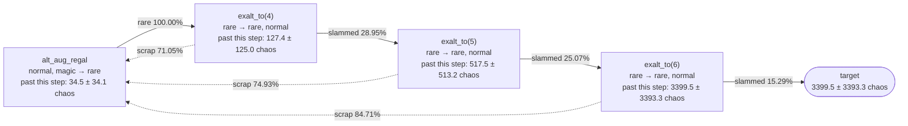
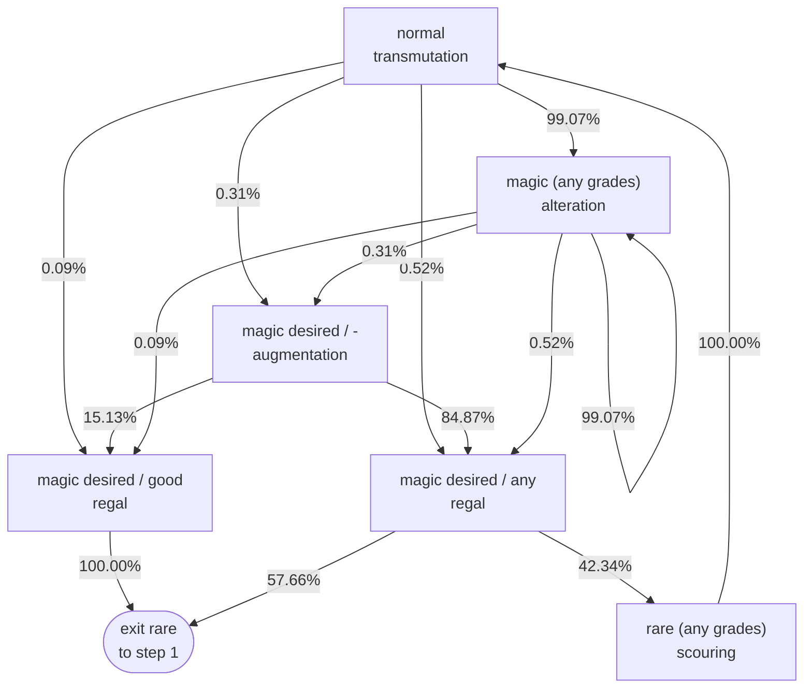
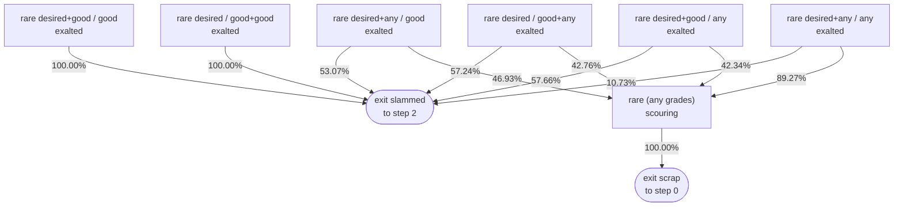
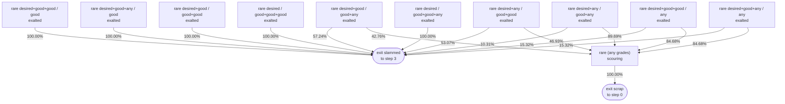
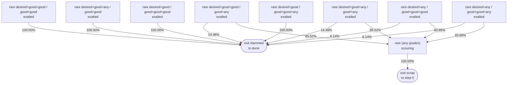

# Supreme Spiked Shield (shaper), item level 87

- prefix pool: 73 modifiers, total weight 64800
- suffix pool: 131 modifiers, total weight 96475
- one desired prefix: 1/81 = 1.2346%
- one good prefix: 5/81 = 6.1728%
- one good suffix: 584/3859 = 15.1335%
- target: a rare item, prefixes [desired, good, any], suffixes [good, good, any]

The strategy is written down and this says what it costs. A chance is used one step deep; what is carried from step to step is the cost to get there and its spread.

## Currencies

| currency | works on | one use costs | weight (chaos) |
|---|---|---|---|
| transmutation | normal | 1 transmutation | 0.02 |
| alteration | magic | 1 alteration | 0.2 |
| augmentation | magic | 1 augmentation | 0.05 |
| regal | magic | 1 regal | 0.5 |
| exalted | rare | 1 exalted | 2 |
| scouring | magic, rare | 1 scouring | 0.5 |

## Craft: shield (forward)

| step | method | takes | chance | tries | one run costs | cost to get past it | chaos ± sd |
|---|---|---|---|---|---|---|---|
| 0 | alt_aug_regal | normal, magic | 100.00% | 1.00 | alteration 167.01, augmentation 0.52, regal 1.56, scouring 0.56, transmutation 1.56 | alteration 167.01, augmentation 0.52, regal 1.56, scouring 0.56, transmutation 1.56 | 34.5 ± 34.1 |
| 1 | exalt_to(4) | rare | 28.95% | 3.45 | exalted 1.00, scouring 0.71 | alteration 576.81, augmentation 1.80, exalted 3.45, regal 5.39, scouring 4.39, transmutation 5.39 | 127.4 ± 125.0 |
| 2 | exalt_to(5) | rare | 25.07% | 3.99 | exalted 1.00, scouring 0.75 | alteration 2300.85, augmentation 7.17, exalted 17.77, regal 21.50, scouring 20.50, transmutation 21.50 | 517.5 ± 513.2 |
| 3 | exalt_to(6) | rare | 15.29% | 6.54 | exalted 1.00, scouring 0.85 | alteration 15044.32, augmentation 46.87, exalted 122.70, regal 140.60, scouring 139.60, transmutation 140.60 | 3399.5 ± 3393.3 |

Whole craft, per orb: alteration 15044.32 ± 15044.82, augmentation 46.87 ± 47.03, exalted 122.70 ± 120.50, regal 140.60 ± 140.10, scouring 139.60 ± 140.10, transmutation 140.60 ± 140.10

## Method: alt_aug_regal (step 0)

## Method: exalt_to(4) (step 1)

## Method: exalt_to(5) (step 2)

## Method: exalt_to(6) (step 3)

## Other moves

84 other moves checked at 68 places the craft passes through; 6 cost less to finish, by the weights.

| step | item | visits | planned | to finish (chaos) | instead | to finish (chaos) |
|---|---|---|---|---|---|---|
| 0 | magic good / good | 70.93 | alteration | 3399.70 | regal | 3375.84 |
| 0 | magic - / good | 574.50 | alteration | 3399.70 | augmentation | 3398.46 |
| 0 | magic good / - | 234.34 | alteration | 3399.70 | regal | 3397.74 |
| 0 | magic - / good | 574.50 | alteration | 3399.70 | regal | 3399.50 |
| 0 | magic - / any | 3221.73 | alteration | 3399.70 | augmentation | 3399.67 |
| 0 | magic good / any | 397.74 | alteration | 3399.70 | regal | 3399.54 |

